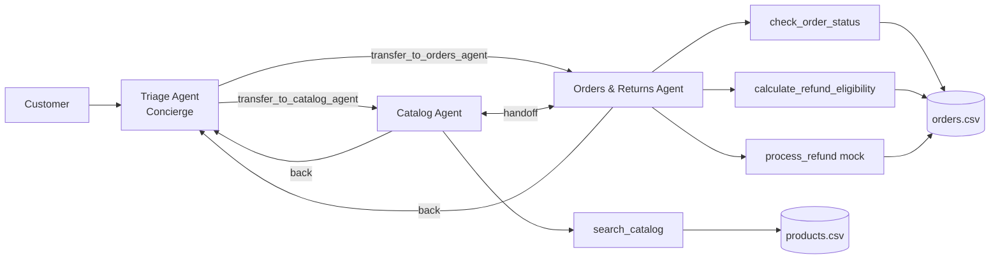

# 🛍️ SwiftSupport Commerce

An open-source, multi-agent **E-Commerce Customer Support & Concierge** system built with
**LangGraph** and **Groq** (free tier), backed by mock CSV datasets.

🚀 **Live demo:** <https://farazmalik180-swiftsupport-commerce-streamlit-app-rwulgl.streamlit.app/>

## Architecture



**Why LangGraph?** Handoffs are explicit graph edges, state is checkpointed per `thread_id`
(the active agent persists across turns), and the loop is deterministic and easy to test.

| Agent | Role | Tools |
|---|---|---|
| Triage (Concierge) | Greets, clarifies intent, routes | `transfer_to_catalog_agent`, `transfer_to_orders_agent` |
| Catalog | Discovery, availability, upsells | `search_catalog`, handoffs |
| Orders & Returns | Tracking, lookups, mock refunds | `check_order_status`, `calculate_refund_eligibility`, `process_refund`, handoffs |

Every agent's system prompt (see [app/prompts.py](app/prompts.py)) enforces a
**Thought → Tool Call → Observation** loop. The UI shows this trace per reply.

## Tool schemas

All tools live in [app/tools.py](app/tools.py), take and return strings, and never raise.

| Tool | Signature | Behaviour |
|---|---|---|
| `search_catalog` | `(query: str) -> str` | TF-IDF-style keyword search over name/category/description; understands `under $N`; flags stock levels; top 5 results |
| `check_order_status` | `(order_id: str) -> str` | Accepts `ORD-10001`, `10001`, `ord10001`. Unknown (or someone else's) ID returns a message asking for clarification |
| `calculate_refund_eligibility` | `(order_id: str) -> str` | Delivered and ≤30 days → `Approved`. Otherwise `Denied` / `Not Yet Eligible` with the policy reason |
| `process_refund` | `(order_id: str) -> str` | Mock refund; succeeds only when `Approved` |

**Return policy:** Delivered orders are refundable within 30 days of purchase. Processing orders can
be cancelled; Shipped orders become eligible after delivery; Cancelled/Returned orders are not refundable.

## Quick start

```bash
python -m venv .venv && source .venv/bin/activate   # Windows: .venv\Scripts\activate
pip install -r requirements.txt
cp .env.example .env                                # then set GROQ_API_KEY
streamlit run streamlit_app.py                      # web UI
python main.py --trace                              # or CLI with reasoning trace
```

Get a free key at <https://console.groq.com/keys>.

### Configuration (`.env`)

| Variable | Default | Purpose |
|---|---|---|
| `GROQ_API_KEY` | – | Required |
| `GROQ_MODEL` | `openai/gpt-oss-120b` | Primary model |
| `GROQ_FALLBACK_MODEL` | `openai/gpt-oss-20b` | Used if the primary errors or is rate-limited |
| `REFERENCE_DATE` | real today | Pins "today"; the sample data is anchored to `2026-10-21` |

> `llama3-70b-8192` and `mixtral-8x7b-32768` have been retired by Groq. Model availability varies by
> account; list yours with `groq.Groq().models.list()` and set `GROQ_MODEL` to any tool-calling model.

## Authentication and access control

Customers sign in with a customer ID and PIN (PBKDF2-hashed in `data/customers.csv`, 5 failed
attempts lock the account for 5 minutes). See [app/auth.py](app/auth.py).

- The authenticated `customer_id` lives in the graph state and is **injected into every order tool
  by the application**. The LLM never sees or supplies it, and any `customer_id` it tries to pass
  is discarded.
- Orders owned by someone else look exactly like non-existent orders, so IDs can't be probed.
- Without a login the order tools refuse to run.

**Demo credentials:** `CUST-001` / `1001`, `CUST-002` / `1002`, … `CUST-012` / `1012`.
Example: `ORD-10002` belongs to `CUST-002`, so `CUST-001` asking about it gets "not found".

> This is a demo scheme for mock data. For production use a real identity provider (OAuth/SSO).

## Tracing (optional, LangSmith)

Set these in `.env` (or your host's secrets) to trace every turn, LLM call and tool call at
<https://smith.langchain.com> (free tier):

```
LANGSMITH_TRACING=true
LANGSMITH_API_KEY=...
LANGSMITH_PROJECT=swiftsupport-commerce
```

Runs are tagged `swiftsupport` with `customer_id` and `thread_id` metadata. The sidebar shows
"LangSmith tracing is on" when enabled. Tracing sends prompts and customer messages to LangSmith,
so leave it off for sensitive data.

## Testing

```bash
pytest                      # 23 offline tests (tools, auth, access control); no API key needed
python -m tests.evaluate    # live 8-case batch test of the agents (uses Groq)
```

## Free hosting

### Streamlit Community Cloud
1. Push this repo to GitHub (`.env` is git-ignored).
2. Go to <https://share.streamlit.io> → **New app** → select the repo, main file `streamlit_app.py`.
3. **Advanced settings → Secrets**, add:
   ```toml
   GROQ_API_KEY = "gsk_..."
   REFERENCE_DATE = "2026-10-21"
   ```
4. Deploy.

### Hugging Face Spaces (Docker)
1. Create a Space → SDK **Docker** (blank template).
2. Push this repo to the Space. Add this front-matter at the top of the Space's `README.md`:
   ```yaml
   ---
   title: SwiftSupport Concierge
   sdk: docker
   app_port: 7860
   ---
   ```
3. **Settings → Variables and secrets** → add secret `GROQ_API_KEY` (and `REFERENCE_DATE`).
   The included [Dockerfile](Dockerfile) serves Streamlit on port 7860.

## Project layout

```
app/        agents.py (graph), tools.py, auth.py, prompts.py, state.py, config.py
data/       products.csv, orders.csv, customers.csv
tests/      test_tools.py, test_auth.py (offline), evaluate.py (live batch eval)
main.py     CLI chat          streamlit_app.py   web chat UI
Dockerfile  .env.example  requirements.txt
```

## Limitations
Mock data only, with a demo-grade login (see above). Refunds are simulated.

## License
MIT
